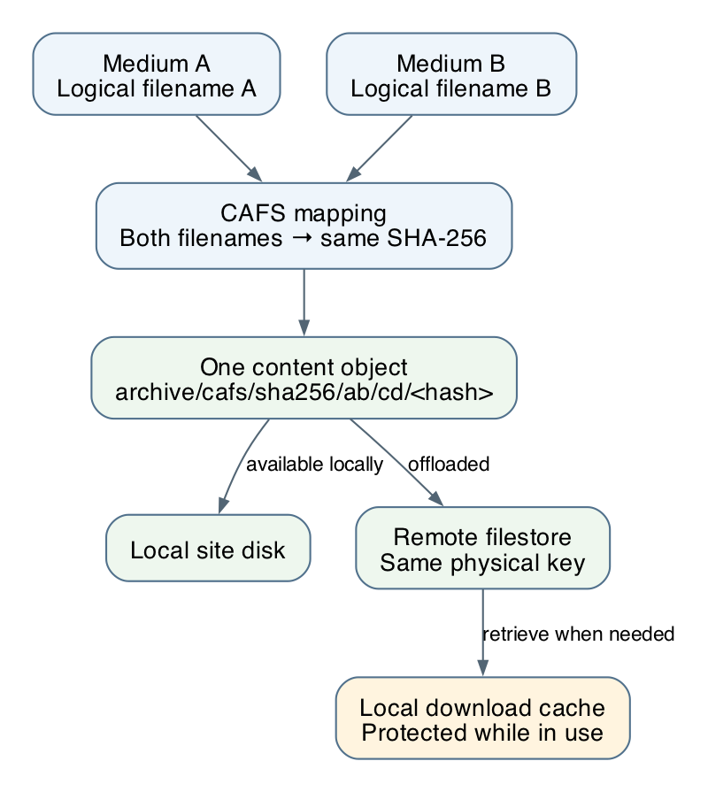
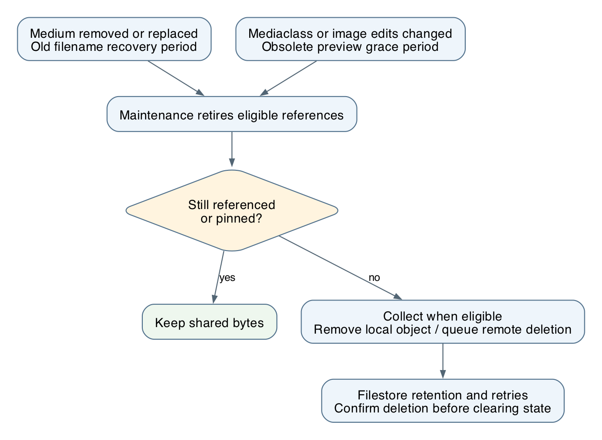

---
keywords:
  - explanation
  - backend_developer
  - operator
  - media_management
  - file_storage
  - cache
  - backup_and_restore
---

# How Zotonic stores and collects media files

Zotonic separates a media resource's identity from its file bytes. A resource has a
medium record with a logical filename and metadata. **CAFS**, the content-addressable
file store, lets several logical filenames share the same bytes. **Filestore** can
move those bytes to remote storage and retrieve them when needed.

These layers work together. CAFS decides which content is shared and still needed;
filestore manages where the bytes are available. The [mediarunner](mediarunner.md)
adds an optional processing service, with its own temporary cache. It does not
replace the site's media store.

## From a medium record to bytes



| Layer | What it represents |
| --- | --- |
| Resource and medium | Ownership, metadata, access rules and logical filenames |
| CAFS mapping | The SHA-256 content hash behind a logical filename |
| Physical storage | The local file or its remote filestore object |
| File cache | A local copy used while serving or processing remotely stored bytes |

A content hash is an identity for bytes, not an authorization token. Two resources
can share content while retaining different permissions. Public media delivery still
uses the requesting resource's access rules and the normal signed preview URLs.
Applications should use Zotonic's media and file APIs rather than construct public
URLs from physical hashes.

## Where files live

Paths below are relative to the site's files directory, normally beneath
`<data_dir>/sites/<site>/files/`:

| Path | Purpose |
| --- | --- |
| `archive/cafs/sha256/ab/cd/<hash>` | A CAFS object: an original, poster, shared preview or retained task input |
| `archive/<logical-filename>` | An older file that has not been promoted to CAFS |
| `preview/<preview-filename>` | Legacy previews and previews on database-free sites |

Before a browser uploads a file, Zotonic hashes it in a worker and checks for a
matching current medium that the user can view. A match skips the browser transfer;
a miss uploads normally. Older originals with a known matching checksum are
lazily promoted to CAFS; files without a checksum upload normally. Reuse still runs the normal validation and media processing,
and may fetch remote-only bytes on the server. See [m_media](model#media) for the
upload preflight API and its short-lived, user-bound token.

The CAFS path uses `cafs` **without a leading dot**. Its first two directory levels
come from the first four hash characters. The complete hash is 64 lowercase
hexadecimal characters, and the object path has no file extension. MIME type and
the logical filename remain part of the media metadata.

New files are hashed when staged, then attached to their logical filenames. Fresh
private upload copies are hashed once, and the medium digest reuses that hash.
Legacy files and other potentially mutable sources are hashed before copying and
again afterward, rejecting changes during copying. Copying
an existing CAFS-backed medium can share the mapping without copying or downloading
its bytes. A medium copy also brings its owned original and poster into CAFS where
needed; it preserves independent resource metadata and permissions. See
[the media model](model#media) for the copy APIs and [the CAFS model](model#cafs)
for staging, attachment and temporary access to local bytes.

Existing installations do not need a mass migration. Older files, with or without
an existing SHA-2 checksum, continue to work. Available bytes can be hashed and
promoted during an operation such as copying. An existing checksum alone is not a
substitute for a CAFS mapping. Installation does not download all remote files to
calculate hashes. An operation that actually needs a legacy file may still need to
retrieve that particular file.

## Shared previews

A preview is determined by its original content and the effective rendering
operations. For example, two resources using the same original and the same resize
can share one generated result. Changing operation order can change the output,
so operation order is part of the identity.

CAFS identifies a derivative using the source hash, effective operations and
renderer identity. The preview pipeline also includes the rendering metadata and
output format that affect the result. Concurrent requests share generation work.
The resulting preview bytes are stored as another CAFS object.

Zotonic tracks **uses of a preview** separately from the generated bytes. A use
records the source and the relevant mediaclass and image-edit revision. This lets
an old URL become obsolete while another resource still uses the same output.

When changing rendering dependencies outside the operations themselves, such as
fonts or policy, update the site's `site.cafs_renderer_version` and invalidate
running file entries with `z_file_sup:refresh/0`. If a mediarunner is used, review its
separate `mediarunner_cache_version` too; both caches must distinguish the new output.

## Adding remote filestore

Enable [mod_filestore](module#mod_filestore) and open **System → Cloud File Store**
in the admin. Configure a site-specific storage location and credentials, enable
uploading, and choose whether to keep local copies and how long to delay remote
deletion. Saving the configuration tests writing, reading and deleting a temporary
object. Follow it with a normal image upload and preview request.

Filestore supports S3-compatible storage, FTP over TLS and WebDAV. Use the module's
setup documentation for URL schemes, S3 regions and required permissions. Keep the
remote location private; Zotonic can serve files through its normal access checks.

For CAFS objects, filestore uses the same physical key, including the
`archive/cafs/sha256/…` path. Shared previews therefore also live under `archive/`
in remote storage. Older preview files can still use `preview/`. Storage policies
and permissions need to allow both layouts during migration.

After upload, a site can retain the local copy or let it be removed. A later read
of a remote-only object obtains a local cached copy. Processing holds the required
file protection while reading, so cache eviction does not remove an active input.
The registry and retry queues survive temporary storage failures. Bulk downloads
verify the recorded size and, for CAFS objects, the SHA-256 hash before publishing
the local file or scheduling removal of the remote copy. Failed downloads remain
queued with backoff; restarting the bulk operation is not required.

Use Zotonic's supported bulk upload and move operations when changing storage.
Avoid moving or deleting objects by hand: database mappings, shared references,
remote locations and pending deletions must stay consistent. The
[filestore model](model#filestore) and module documentation describe those operations.

## What garbage collection removes

Deleting one medium does not necessarily make its bytes disposable. Another
logical filename, a preview relationship or a processing task may still need them.
A **pin** is a retention reference held while an operation needs an object. Staging
pins expire; longer-lived tasks, such as video conversion, retain their inputs until
completion or reconciliation.



There are several retention stages, rather than one universal deletion timer:

| Event | What happens |
| --- | --- |
| A medium is deleted or replaced | Its old filename remains available for the existing five-week recovery period before cleanup retires the mapping. |
| All preview sources are removed | Their preview uses become obsolete; shared uses and processing references can still retain the output. |
| A URL's mediaclass checksum or image-edit revision is superseded | That preview use becomes obsolete and enters the preview grace period. |
| No required references remain | Bounded maintenance can collect the CAFS object when its collection deadline permits. |
| A remotely stored object is collected | Filestore applies its remote deletion policy and retains deletion state until the operation is confirmed. |

Obsolete preview uses have a default **90-day grace period**. Requests to an
obsolete URL do not keep extending that deadline. Reverting settings can make a use
current again. Cleanup also handles tracked legacy preview paths. Existing
unversioned URLs use a first-observed edit baseline, so upgrading does not invalidate
all old previews at once.

Collecting the last source object can also release its derivatives after the source
recovery period; the preview grace period does not keep an otherwise unreferenced
original alive.

Collection is lazy and runs in batches. The grace periods, remaining references,
maintenance schedule, storage outages and remote deletion policy all affect when
bytes finally disappear. Do not expect every associated preview to vanish
immediately when the last visible medium is deleted. A filestore setting of
**Never** deliberately prevents remote deletion.

Private preview and download artifacts are a separate cleanup concern. Worker
monitors remove temporary files after failure, and a bounded sweep removes eligible
old orphan artifacts after a restart. This does not treat ordinary previews as
expired merely because their files are old.

## Configuration and maintenance

The main CAFS controls are per-site **`m_config` settings**, under the `site`
namespace:

| Key | Default | Purpose |
| --- | --- | --- |
| `site.cafs_preview_retention_days` | `90` | Grace period for obsolete preview uses |
| `site.cafs_renderer_version` | `1` | Additional rendering identity after changes outside the recorded operations |

For example:

```erlang
m_config:set_value(site, cafs_preview_retention_days, 180, Context).
```

These are different from system-level mediarunner connection settings and
`mod_filestore`'s storage configuration. CAFS is installed by Zotonic's core schema;
there is no separate CAFS module to activate. See [m_cafs](model#cafs) for accepted
values, maintenance APIs and reference handling.

For capacity planning, account for retained originals, obsolete previews during
their grace period, remote download caches and active processing files. If storage
keeps growing, inspect upload/deletion backlogs, retained processing tasks, preview
retention and the remote deletion policy before removing files manually.

Back up the database and the authoritative media bytes together. A local cache may
contain only a fraction of remotely stored media, and the mediarunner cache is not
a backup. Keep the remote credentials and storage configuration needed for recovery.
See [backup and restore](module#mod_backup) for the supported workflow.

## Delete all generated previews

On **Maintenance → Media**, use **Delete generated previews** to queue a complete
cleanup of resized image variants. The action requires permission to use
`mod_admin_config` and runs in bounded background batches, visible in the task queue.

It clears CAFS derivative references and legacy files in the generated `preview/`
directory, including library-image variants. It also removes pending uploads of
old legacy variants and queues their remote deletion. Filestore retention and
read-only settings still apply; an unavailable backend is retried.

Uploaded originals and all medium `preview_filename` images (movie posters, PDF
covers, embed thumbnails, etc.) are preserved. Those stored preview originals
belong to the archive, including `archive/preview/`, rather than the generated
preview directory. CAFS objects shared with originals, stored previews, other
references or active processing remain protected.

Previews regenerate on demand. The task uses a fixed cutoff, so it does not keep
collecting newly created variants while visitors browse. Active CAFS generators
finish before their old derivative references are removed. Cleanup preserves URL
obsolescence records, so old invalid mediaclass/edit URLs do not become valid again.

## Backend deletion coordination

Remote deletion is coordinated through `#filestore{action=delete_status}`. The
backend reports `absent` only after both its remote records and queued uploads
are gone; otherwise cleanup retains its tombstone and retries. This also applies
to legacy files and preview prefixes. Repeated checks preserve the backend's
retention deadline.

The internal `site.filestore_used` marker records whether a backend has ever been
installed. It is maintained automatically, including an upgrade backfill for
previously installed filestore modules; it is not an administrator setting and
must not be reset when disabling filestore. Without a handler, sites carrying
this marker defer cleanup. Sites that have never used a backend can still clean
up local files. Backend implementations must set this marker before accepting
files and implement the deletion-status notification.

## Sites without a database

Sites such as `zotonic_site_status`, configured with `dbdatabase = none`, skip CAFS.
Their occasional library previews are written to the ordinary `preview/` directory
and need no preview garbage collection. They require neither CAFS tables nor remote
filestore to generate those previews.

This behavior is selected by site configuration. A temporary database outage on
a database-backed site does not switch its files into a different storage model.

## Deduplicating existing media

Use **Maintenance → Media → Deduplicate media files**, or call
`m_media:migrate_to_cafs(Context)` with `use mod_admin_config` permission.
The background scan visits every medium present when it starts, including its
owned original and its extracted preview image (`preview_filename`). Logical
filenames and media URLs remain unchanged. Identical bytes share one CAFS object.

Local files are hashed even when they have no checksum yet. Remote-only originals
with a valid SHA-256 digest can reuse their existing remote location without a
download. Remote-only files without a checksum, including extracted previews,
are skipped and logged. This operation never downloads files merely to hash them;
rerun it after making missing bytes available locally if needed.

The scan runs in bounded batches, and individual files retry independently after
failures. Cleanup also retries separately. A redundant local copy is removed only
after the CAFS mapping is published and a canonical copy is available. A legacy
remote copy is retired only after a healthy canonical remote entry exists. When
reusing an existing remote object, its registry path changes atomically with the
CAFS attachment; the remote URL and bytes stay in place. Deletion of redundant
remote objects follows the filestore retention policy (including
**Never**). Disabled or read-only backends delay cleanup. It is safe to rerun the
operation; tasks resume after a restart. This does not delete extracted preview
originals or regenerate resized previews.

Both media maintenance actions only queue work from the admin request. Durable
background tasks perform the scan, hashing and cleanup, and resume after restarts.
The **Maintenance** and **System status** pages show **Running**, **Queued / waiting**
or **Idle** for each operation and refresh every five seconds. Deduplication remains
pending while its per-medium or legacy-cleanup tasks remain, even after the scan
finishes. These are task counts, not file counts. Idle means no maintenance tasks
remain; remote objects already marked for deletion still follow filestore retention.

### On-demand promotion and legacy previews

Requests for owned legacy originals also trigger background promotion. Local files
can be hashed immediately; a remote file is promoted after the download already
started by the request completes. The response does not wait for hashing, and no
additional download is started for promotion. The worker holds a cache lock while
using downloaded bytes and rechecks the medium before attaching them. It updates
the original checksum and uses the same remote adoption and legacy cleanup as
maintenance migration. Extracted posters are handled as owned source files, too.

Unowned files and database-free sites are excluded. An overloaded worker pool,
failed download, or download that has not completed within five minutes leaves
the legacy file usable; promotion can be tried on a later cold lookup. Completed
promotions queue durable cleanup, including retries for a busy filestore.

Opening a media overview may request previews of older files. When new rendering
is necessary, promotion first tries to reuse the original's existing remote
location. Busy uploads and unavailable storage are retried before allowing a new
CAFS upload. Redundant legacy paths use the same background cleanup as maintenance
migration; remote removal respects retention.

The `editrev` URL addition alone no longer forces regeneration. If the source,
mediaclass checksum and edit revision are current, lookup also tries the old URL
with exactly the same rendering operations and output extension. Existing local or
remote preview bytes are promoted into CAFS without resizing. This requires a
known source hash: local sources are migrated on demand, and remote sources with a
known checksum can be adopted. Remote sources without a checksum keep their legacy
previews until the original becomes available; promotion does not download those
originals. A remote preview itself may be downloaded to calculate its output hash.

Promotion publishes the shared derivative before background cleanup removes its
old local path. Cleanup adopts an existing remote object without uploading it again,
or retires a redundant remote copy according to filestore retention. Busy uploads
and unavailable backends are retried. Local-only outputs become eligible for normal
CAFS upload once remote absence is confirmed.

On subsequent cold lookups, a registered current URL resolves directly to its CAFS
output. This uses two metadata reads (the output mapping and current source), plus
any uncached edit settings and the protected physical file/filestore lookup.
Registering a CAFS reader briefly locks the object row to exclude concurrent
collection or local offloading before the file is opened. It avoids legacy
path probes and usage metadata writes. Source, mediaclass, edit revision and renderer
version checks remain enforced; obsolete URLs still follow the retention path.
Changed operations produce a different legacy path, and invalid signatures cannot
use the fallback. Database-free sites continue to use their local preview directory.

### Legacy-file migration safeguards

Original mappings and promoted preview outputs commit together with their cleanup
tasks. A rollback or restart cannot publish a migration while losing its required
cleanup. Files that disappear or change during staging are left for a later retry.
Unowned source files are neither promoted nor removed, including when a resizer
requests them. Cleanup also preserves an original path shared with an unowned
medium reference.

Legacy local copies stay in place while a file entry still uses them. Cleanup
retries after those entries go idle, instead of interrupting a response. Completed
filestore downloads are resolved by their stable cache key, so promotion and reads
continue to work after the temporary download process exits.

When `mod_filestore.is_local_keep` is false, adopted remote objects also enter the
normal filestore queue for local offloading. This does not upload the object again.
Active CAFS pins and file entries postpone removal of the local canonical copy.
