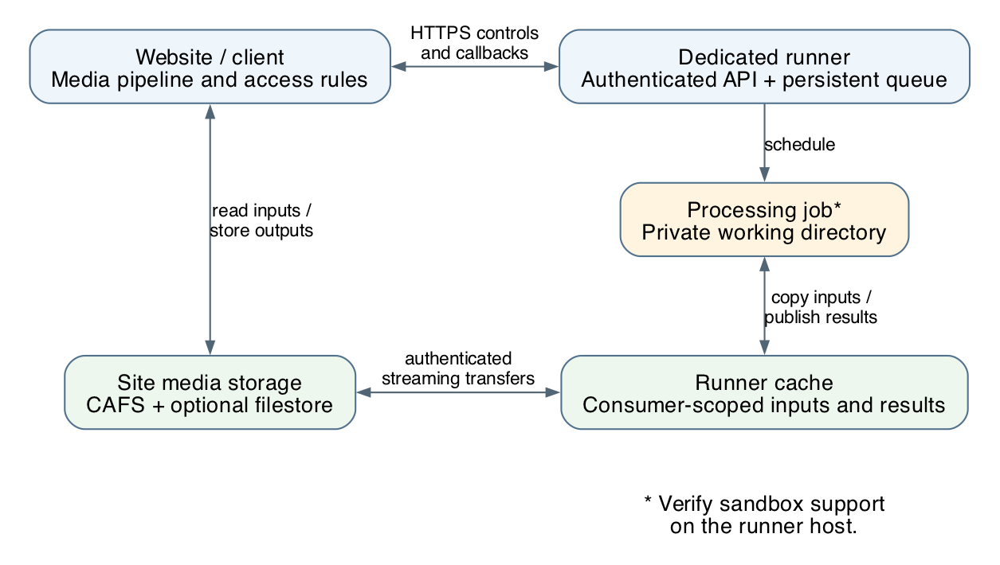
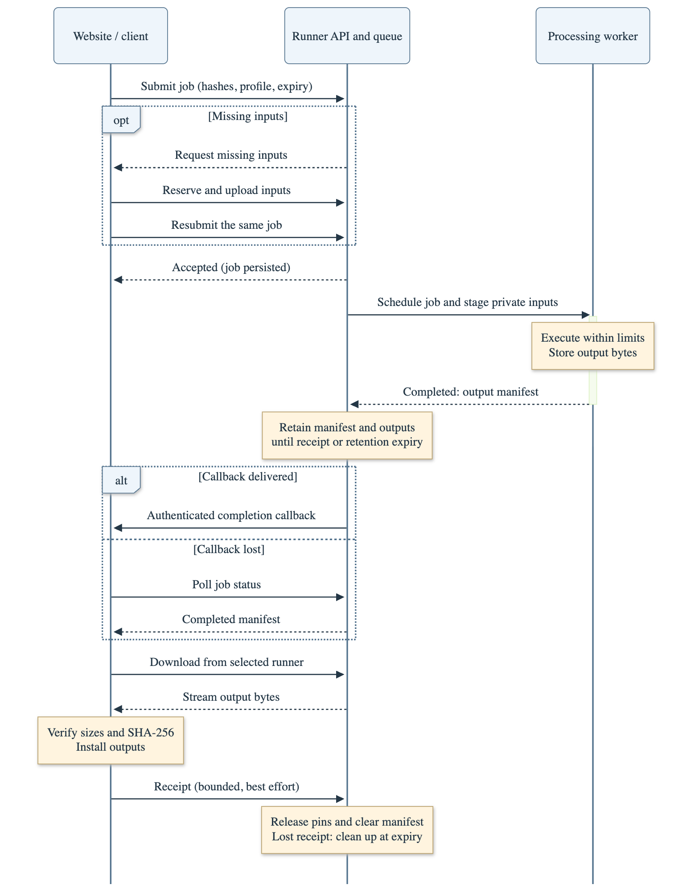

---
keywords:
  - explanation
  - backend_developer
  - operator
  - media_management
  - file_storage
  - api_and_integration
---

# Running media processing on a separate host

Image resizing, PDF previews and video conversion can use considerable CPU, memory
and temporary disk space. The **mediarunner** is a dedicated Zotonic site that
performs this work for other Zotonic installations. Moving processing to a runner
lets you size and maintain the processing host separately from the websites.

The website still owns its media records, access rules and stored files. The
runner receives the inputs needed for a job and returns its outputs. Its cache
helps avoid repeated transfers and rendering; it is not the website's permanent
media store. See [how Zotonic stores files](file-storage.md) for that part.

## The parts of the system



A runner has a PostgreSQL database for its queue and cache registry, persistent
disk for cached inputs and results, and private working directories for commands.
General jobs and full ffmpeg video conversions have separate worker pools, so a
long video conversion need not hold up image previews or video thumbnails.

On the website, Zotonic's media pipeline chooses the appropriate processing
profile automatically. Custom Erlang code uses `z_exec:run/4` with a profile, a
site context, and explicit `read` and `write` paths. Plain `z_exec:run/1,2` commands
remain local. See [the execution API](../../apps/zotonic_core/src/support/z_exec.erl) for the profile interface.

## Set up a runner

1. Install the [mediarunner site](https://github.com/zotonic/mediarunner) under
   `apps_user/mediarunner` in a compatible Zotonic checkout. Use a dedicated host
   or container, with persistent disk and OS or container resource limits.
2. Install the sandbox helper and the required processing tools. Typical installs
   need ImageMagick, ffmpeg, ffprobe and Ghostscript for PDF processing. Install the
   fonts and ImageMagick policy that your previews require, too.
3. Set the runner hostname, database, TLS and administrator credentials in private
   site configuration, then enable the site. The supplied site configuration is
   disabled. Budget disk for both the persistent cache and concurrent job copies.
4. Check `z_exec:sandbox_status/0` on the runner and the isolation indicator on its
   dashboard. Confirm the actual restrictions on the deployment platform before
   accepting jobs.
5. In the runner dashboard, choose **Add website / consumer**. Store the generated
   OAuth2 bearer key securely; it is shown only once. Use a separate consumer for
   each client installation that should have its own cache access and statistics.

The runner's [deployment documentation](https://github.com/zotonic/mediarunner/blob/master/docs/docker.md)
and [configuration reference](https://github.com/zotonic/mediarunner/blob/master/docs/reference.md)
cover installation commands, capacity limits and container setup.

## Connect the website

Add these entries to the `zotonic` application section of the **client's system
configuration**, `zotonic.config`:

```erlang
{media_runner_hostname, <<"media.example.com">>},
{media_runner_oauth2_key, <<"YOUR-OAUTH2-BEARER-TOKEN">>},
{media_runner_local_fallback, false}
```

The hostname can include a port. HTTPS is required, certificates are checked, and
redirects are refused. Keep the `file` utility installed on the client for local
MIME detection. Without a configured runner, processing stays local.

The runner must also be able to reach the website's canonical HTTPS callback URL.
Behind a load balancer, route callbacks to the **Zotonic node that submitted the
job**: the waiting callback registration belongs to that node. Check the site's
canonical hostname and proxy configuration, rather than relying on the hostname
of an incoming browser request.

Allow streaming PUTs and GETs through the runner's reverse proxy. Avoid buffering
large file transfers, and set request-size and timeout limits appropriate for the
largest media you accept. The control API and byte transfers use different routes:

| Traffic | Route on the runner |
| --- | --- |
| Job submission, status, capabilities and receipt | `/api/model/mediarunner_job/…` |
| Input uploads | `/media-runner/jobs/files/:hash` |
| Result downloads | `/media-runner/jobs/results/:hash` |

Start with a test image and resized preview, then a small video. Check queue
completion, callback delivery and successful downloads. For several processing
hosts, use the client runner-pool configuration described in the runner's
[pool guide](https://github.com/zotonic/mediarunner/blob/master/docs/pool.md).

## What crosses the network



In the sequence diagram, time flows downward; labelled conditional exchanges occur
only when inputs or callbacks are missing. The worker represents the runner’s
processing service, which stages inputs and stores outputs around the sandboxed
command.

The job describes the command, profile, input hashes, output files and expiry.
Small control messages use JSON. File bytes are streamed separately, rather than
embedded in JSON. If the runner already has an input for that consumer, the client
can reuse it. Concurrent clients reserve a missing hash so only one uploads it.

The runner persists accepted jobs before processing. A completed job produces a
manifest containing output sizes, SHA-256 hashes and authenticated download URLs.
The callback announces that manifest; status polling can recover a lost callback.
The client accepts result URLs only from the selected runner endpoint and verifies
sizes and hashes before publishing the downloaded outputs.

**Callback delivery and file receipt are different events.** The runner retains a
completed manifest and its protected outputs until the client acknowledges receipt
or result retention expires. The default retention is one day after completion.
Status recovery remains available during that window even after execution expiry.
The client's receipt acknowledgement is bounded and best effort; losing it leaves
cleanup to the retention policy.

## Isolation and trust

On supported systems, commands run with profile-specific filesystem and resource
restrictions and without network access. They can use their staged inputs,
outputs, scratch space and required tool/runtime files. They cannot access the
shared cache directly. Inputs are copied into private job directories, so a command
that overwrites an input cannot alter another job's cached original.

Isolation depends on the host. Unsupported operating systems, including Linux
without the required Landlock support, can continue **without sandbox isolation**
and display an alarm. Missing helpers or other sandbox setup failures on supported
systems block processing. Check the runner dashboard and `z_exec:sandbox_status/0`;
a running service alone does not prove that isolation is active.

Bearer keys authorize command execution within the selected profiles. Issue them
only to trusted clients, use separate consumer accounts, and rotate keys when
access changes. Native sandboxing complements host isolation and resource limits;
limits on individual processes do not provide a single budget for every delegate
a command might start. See the runner's configuration reference for the exact
platform behavior and permissions.

## Timeouts, retries and maintenance

Three different waits matter:

- A browser waits up to five seconds for a preview lookup. Pending or failed work
  returns HTTP 503 with `Retry-After` and `Cache-Control: no-store`; shared generation
  can continue for a later request. Failed previews do not become permanent
  placeholders under the successful preview pathname.
- A command has its profile's execution limit.
- The client has a total operation budget, covering packing, transfers, queueing,
  execution and result installation, including failover. The global
  `media_runner_wait_timeout` sets this budget in seconds. Its default is the command
  timeout plus 300 seconds. Keep client and runner clocks synchronized for wire expiry.

Local fallback is optional and uses the remaining operation budget. It applies to
availability failures, not authentication or integrity failures. Enabling it means
provisioning compatible tools and an appropriate local sandbox policy on the
website host. Keep ImageMagick versions, fonts and rendering policies consistent.

Temporary video-processing failures retain the conversion task and its source.
Automatic retries use backoff and pause after 24 hours of recorded failures;
operator-action errors pause immediately. Deleted or replaced media release retained
inputs during reconciliation. See [video conversion](module#mod_video) for retry
state and administrative recovery.

Watch queue age, failed or paused work, disk usage, callback failures and isolation
status. The runner cache evicts eligible entries; private job directories need disk
space as well. Change `mediarunner_cache_version` after changing rendering dependencies
that are not otherwise reflected in the cache key. The website's CAFS renderer version
is a separate setting, explained in the [file-storage guide](file-storage.md).

Runner capacity and cache settings belong in the **runner's site configuration**;
client connection settings belong in **system configuration**. For detailed control
operations see [the job model](https://github.com/zotonic/mediarunner/blob/master/src/models/m_mediarunner_job.erl), and for consumer credentials
see [the consumer model](https://github.com/zotonic/mediarunner/blob/master/src/models/m_mediarunner_consumer.erl). Upgrade compatible runner and
client versions together; deploy result-retention support before depending on status
recovery. Pending client calls do not survive a client-node restart. There is currently
no remote cancellation API: abandoned remote attempts remain bounded by their expiry.
